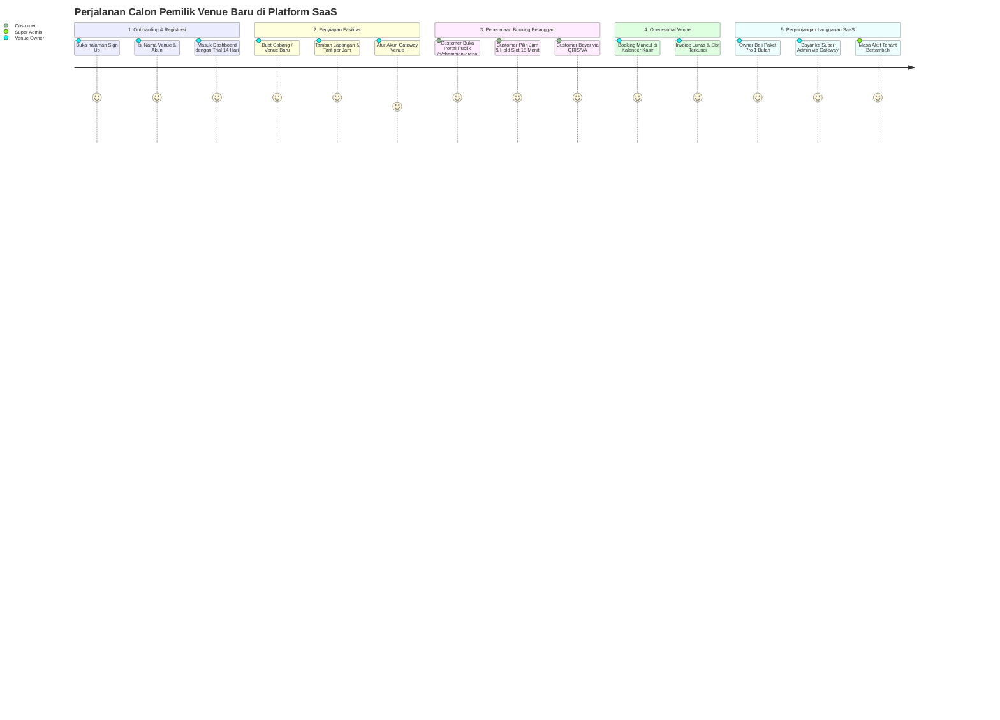

# Panduan Pengujian End-to-End (E2E Testing Guide)
## Dari Sudut Pandang (POV): Calon Pemilik Venue Baru Mendaftar & Menggunakan SaaS

Dokumen ini disusun dari **Sudut Pandang (Point of View / POV) Pemilik Bisnis Olahraga Baru** yang datang ke platform SaaS Anda, mendaftarkan tempat olahraganya dari nol, menyiapkan lapangan, hingga menerima pelanggan pertama yang memesan dan membayar secara online.

---

## 🎭 Daftar Peran (Personas) dalam Pengujian:

| Persona | Nama Karakter | Email / Akses | Peran & Tindakan |
|---|---|---|---|
| **Platform Owner** | Super Admin | `superadmin@gmail.com` | Pemilik Platform SaaS (mengatur harga paket & gateway penerima langganan) |
| **Venue Owner** | Hendra Wijaya (*Champion Arena*) | `hendra@championfutsal.com` | Pemilik Venue Baru yang mendaftar dan mengelola lapangan |
| **Customer** | Budi Santoso | `budi@gmail.com` (Publik) | Pelanggan umum yang booking lapangan di internet |

---

## 🗺️ Peta Perjalanan Pengujian (Testing Journey)



---

## 🎬 LANGKAH DEMI LANGKAH PENGUJIAN (POV TENANT BARU)

### 📌 STEP 1: Persiapan Super Admin (Pemilik Platform SaaS)
*Tujuan: Memastikan gateway pembayaran platform siap menerima uang langganan dari pemilik venue.*

1. Buka browser: `http://localhost:8000/login`
2. Login sebagai Super Admin:
   - **Email:** `superadmin@gmail.com` | **Password:** `password`
3. Buka menu: **Manajemen SaaS Platform > Gateway Platform SaaS** (`/superadmin/payment-settings`).
4. Pastikan Midtrans Snap aktif dalam mode Sandbox, lalu **Logout**.

---

### 📌 STEP 2: POV Pemilik Venue Baru Mendaftar (Self-Service Onboarding)
*Anda sekarang berperan sebagai **Hendra Wijaya**, pemilik venue olahraga "Champion Arena" yang baru menemukan platform SaaS Anda.*

1. Buka halaman registrasi: **`http://localhost:8000/register`** (Bisa gunakan tab browser biasa atau Incognito).
2. Isi formulir pendaftaran tempat olahraga:
   - **Nama Tempat / Venue Olahraga Anda:** `Champion Arena`
   - **Nama Lengkap Penanggung Jawab:** `Hendra Wijaya`
   - **Email:** `hendra@championfutsal.com`
   - **Password:** `Admin123!`
   - **Konfirmasi Password:** `Admin123!`
3. Klik tombol **Daftar Sekarang**.
4. **Apa yang terjadi di balik layar secara otomatis?**
   - Sistem membuat entitas **Tenant baru**: `Champion Arena` dengan slug `champion-arena`.
   - Akun Hendra otomatis menjadi **Tenant Owner (`owner`)**.
   - Sistem memberikan **Trial Paket Starter Gratis selama 14 Hari**, sehingga Hendra langsung bisa menggunakan dashboard tanpa terblokir tagihan!
   - Hendra otomatis login dan diarahkan ke Dashboard.

---

### 📌 STEP 3: Setup Cabang, Lapangan & Tarif oleh Pemilik Venue
*Hendra menyiapkan lapangan olahraganya agar siap dipromosikan ke pelanggan.*

1. **Membuat Cabang Venue:**
   - Buka menu: **Tempat & Fasilitas > Data Venue / Cabang** (`/venues`).
   - Klik **Tambah Venue**:
     - Nama Cabang: `Champion Arena Kuningan`
     - Alamat: `Jl. Rasuna Said No. 45, Jakarta Selatan`
     - Jam Buka: `08:00` | Jam Tutup: `23:00`
     - Status: `Aktif`
     - Klik **Simpan**.
2. **Membuat Unit Lapangan:**
   - Buka menu: **Tempat & Fasilitas > Lapangan & Meja** (`/resources`).
   - Klik **Tambah Lapangan**:
     - Pilih Venue: `Champion Arena Kuningan`
     - Tipe: Pilih tipe yang sesuai (Futsal / Lapangan)
     - Nama Lapangan: `Lapangan Futsal Vinyl 1`
     - Harga Dasar per Jam: `Rp 200.000`
     - Kapasitas: `10` Orang
     - Klik **Simpan**.
3. **Membuat Tambahan Addon (Opsional):**
   - Misal: Sewa Rompi Tim (Rp 20.000) atau Bola Tambahan.
4. **Mengatur Akun Penerimaan Pembayaran Venue:**
   - Buka menu: **Operasional Booking > Gateway Pembayaran Venue** (`/payment-settings`).
   - Masukkan Server Key & Client Key Midtrans milik venue Champion Arena (agar uang booking customer masuk langsung ke rekening Hendra).

---

### 📌 STEP 4: POV Pelanggan Umum (Customer) Booking Lapangan
*Sekarang buka tab browser baru (atau Incognito). Anda berperan sebagai **Budi Santoso**, pelanggan umum yang ingin main futsal.*

1. Buka tautan portal publik milik Champion Arena:
   - URL: **`http://localhost:8000/b/champion-arena`**
2. **Lihat Jadwal & Pilih Jam:**
   - Portal langsung menampilkan nama venue *Champion Arena*, cabang *Champion Arena Kuningan*, dan tanggal hari ini.
   - Pada baris *Lapangan Futsal Vinyl 1*, cari slot jam yang berwarna hijau (misal jam `19:00 - 20:00`).
   - Klik pada slot jam tersebut.
3. **Isi Data Pemesanan:**
   - Durasi: `1 Jam`
   - Nama Pelanggan: `Budi Santoso`
   - No. WhatsApp: `081298765432`
   - Email: `budi@gmail.com`
   - Klik **Lanjut ke Pembayaran**.
4. **Mekanisme Hold 15 Menit Aktif:**
   - Sistem otomatis mengunci slot jam 19:00 tersebut selama 15 menit. Jika ada orang lain yang membuka portal, slot jam tersebut tidak bisa diambil orang lain.
   - Budi diarahkan ke halaman invoice: `http://localhost:8000/invoice/{BOOKING_CODE}`.

---

### 📌 STEP 5: Pelunasan Booking Lapangan
*Budi menyelesaikan pembayaran sewa lapangan.*

1. Di halaman invoice, Budi melihat:
   - Hitung mundur timer 15 menit.
   - Total tagihan: Rp 200.000.
2. **Opsi 1 - Bayar Online Instan (Midtrans):**
   - Klik tombol **"Bayar Sekarang via MIDTRANS"**.
   - Modal popup Snap terbuka. Budi dapat memilih QRIS (GoPay/ShopeePay) atau Virtual Account BCA.
   - Simulasi webhook:
     ```bash
     curl -X POST http://localhost:8000/webhook/payment/midtrans \
       -H "Content-Type: application/json" \
       -d '{
         "order_id": "NOMOR_PAYMENT_BOOKING",
         "transaction_status": "settlement",
         "status_code": "200",
         "gross_amount": "200000.00",
         "signature_key": "VALID_SIGNATURE"
       }'
     ```
   - Invoice langsung berstatus **LUNAS** dan slot terkonfirmasi permanen.
3. **Opsi 2 - Transfer Bank Manual:**
   - Budi transfer ke nomor rekening venue dan mengunggah struk transfer di form bawah.
   - Di dashboard kasir Hendra (`/bookings/calendar`), slot jam 19:00 muncul warna kuning ("Hold: Menunggu Bayar"). Kasir memeriksa struk dan klik **"Konfirmasi Lunas Sekarang"**.

---

### 📌 STEP 6: POV Pemilik Venue Membayar Langganan SaaS Bulanan (B2B)
*Masa trial Hendra akan berakhir, atau Hendra ingin upgrade dari paket Starter ke paket Pro agar bisa menambah lebih banyak lapangan.*

1. Kembali ke browser Hendra (Venue Owner).
2. Buka menu: **Operasional Booking > Perpanjang Langganan SaaS** (`/subscription/checkout`).
3. Hendra melihat status akunnya sedang dalam masa *Trial*.
4. **Pilih Paket:**
   - Pilih paket: **Pro** (Maksimal 10 Lapangan, 5 Staf) - Rp 399.000/bulan.
   - Pilih Durasi: **1 Bulan** (atau 3 Bulan).
   - Metode: **Midtrans**.
   - Klik **Lanjut ke Pembayaran**.
5. Sistem menerbitkan Invoice Langganan Platform: `SUB-YYYYMMDD-XXXXXX`.
6. Klik **"Bayar Sekarang via Midtrans"**:
   - Popup Midtrans Platform terbuka. Uang pembayaran ini masuk ke rekening **Super Admin SaaS** (bukan ke venue).
7. Setelah dibayar, status langganan *Champion Arena* otomatis berubah dari `trialing` menjadi **`active`** dan masa aktif diperpanjang otomatis selama 1 bulan.

---

### 📌 STEP 7: Verifikasi di Sisi Super Admin Platform
*Super Admin memantau seluruh transaksi dan status tenant baru.*

1. Login kembali sebagai Super Admin: `http://localhost:8000/login`.
2. Buka menu: **Manajemen SaaS Platform > Daftar Tenant SaaS** (`/superadmin/tenants`).
3. Super Admin melihat:
   - Tenant baru `Champion Arena` muncul di daftar.
   - Status langganan: Paket `Pro` (Aktif).
   - Jumlah cabang & lapangan yang dimiliki tenant terdata otomatis.
   - Tanggal jatuh tempo bulan depan tercatat rapi.

---

## 🎯 Kesimpulan Hasil Pengujian:
Dengan skenario di atas, Anda telah menguji **siklus penuh (Full Lifecycle)** platform SaaS Anda:
1. Registrasi mandiri pemilik venue baru (Self-service).
2. Multi-tenancy isolasi data lapangan & tarif.
3. Pemesanan publik customer dengan anti-tabrakan jadwal (Hold 15 menit).
4. Dual-Level Gateway: Pemisahan uang langganan SaaS (ke Super Admin) dan uang booking sewa lapangan (ke Pemilik Venue).
